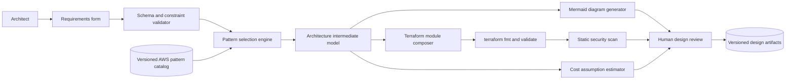

# ArchForge

**Development Status: In Progress**

Constraint-driven cloud architecture studio. This repository currently contains design documentation only. The architecture and features below are proposed; no application implementation is claimed.

## Overview

A cloud architecture studio that converts requirements into reviewable AWS designs and Terraform plans.

## Problem

Turning informal requirements into deployable cloud designs is slow, and generated diagrams can hide missed security, cost, or availability constraints.

## Proposed solution

Capture requirements as structured constraints, select from a small catalog of vetted AWS patterns, and generate a diagram plus Terraform draft. Validation and human review gate every output; no automatic deployment is planned for the MVP.

## Proposed tech stack

TypeScript or Python API, JSON Schema, AWS Pricing Calculator estimates, Terraform, Checkov or tfsec, Graphviz/Mermaid, S3 for design artifacts; optional Amazon Bedrock for requirement extraction.

## Proposed architecture

The [architecture](architecture.md) explains the data flow and boundaries. The [technical design](technical-design.md) defines the first build and evaluation approach.

## Development roadmap

See the [phased development roadmap](development-roadmap.md). It describes planned work without implying that any phase is complete.
