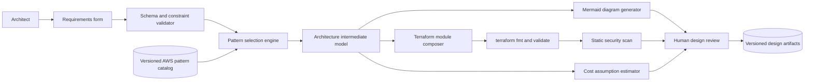

# ArchForge architecture

**Development Status: In Progress** — proposed design, not a deployed system.

## System diagram

## Data flow and boundaries

### Input and intermediate model
Inputs include workload type, region, traffic band, data classification, availability target, and budget ceiling. The validated intermediate model lists AWS resources, connections, constraints, and the reason each pattern was chosen.

### Generation boundary
The MVP supports one bounded reference workload, such as a public API with a database. Modules come from a versioned local catalog. A language model may extract candidate requirements, but cannot invent Terraform resources outside the catalog.

### Validation
Run format, init without backend, validate, security scanning, and custom assertions for encryption, network exposure, and multi-AZ needs. Show failed constraints beside the generated design. Cost is an estimate with explicit usage assumptions.

## Security and operating boundaries

Treat all generated infrastructure as untrusted until reviewed. Use no live cloud credentials in the design pipeline, pin module versions, and require explicit approval before any future apply action.

## Initial deployment approach

Build the smallest local or low-cost proof of concept first. Introduce managed cloud services only after the data contracts and baseline evaluation work locally. Record configuration, dataset versions, and costs so results can be reproduced.
